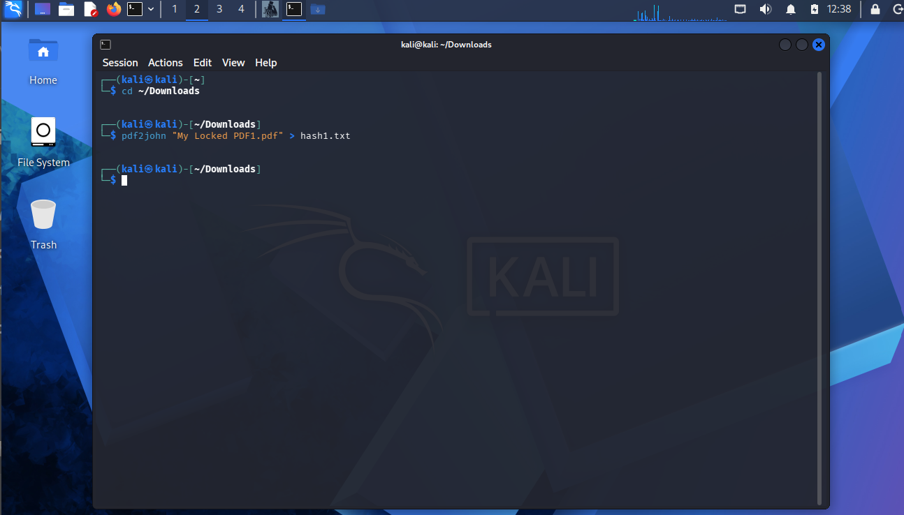
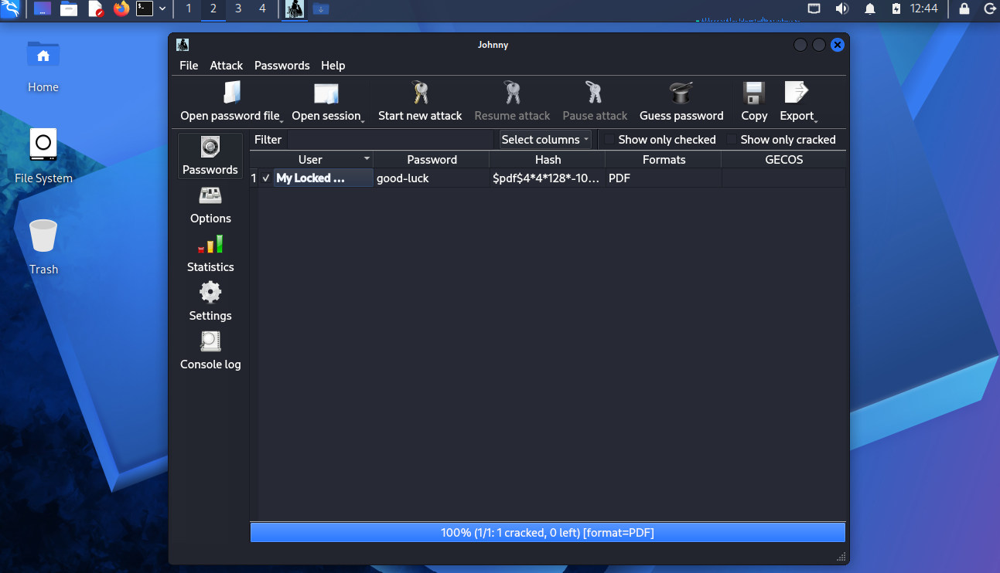
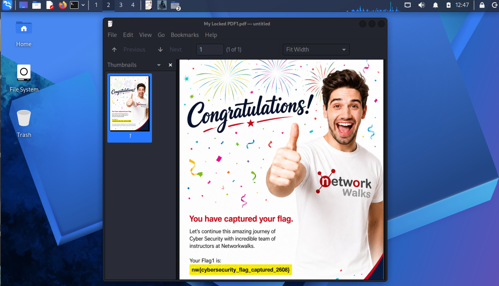
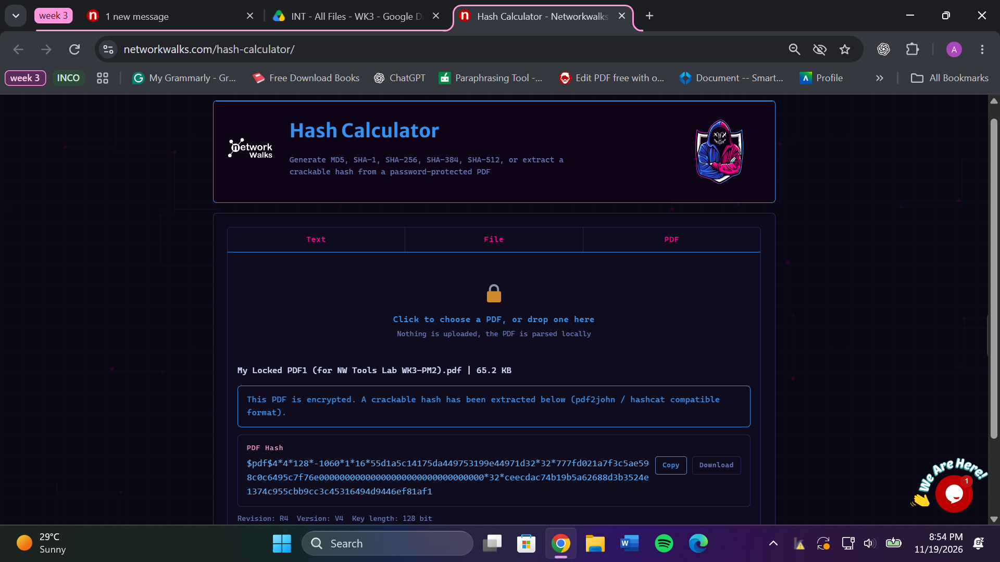
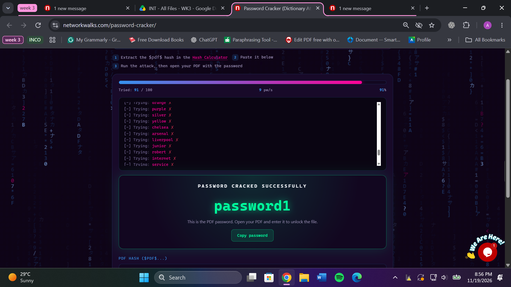
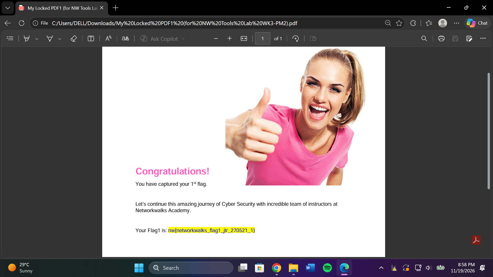
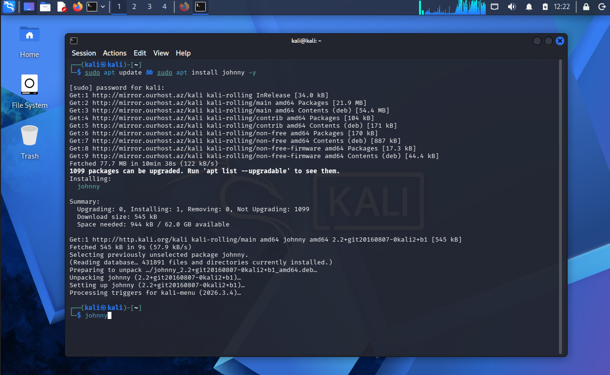
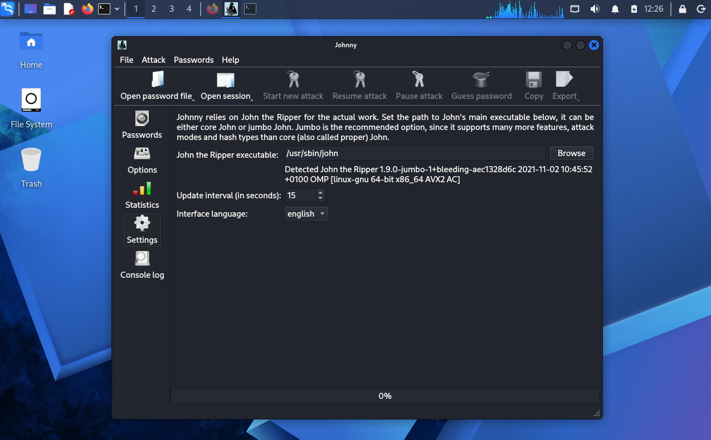
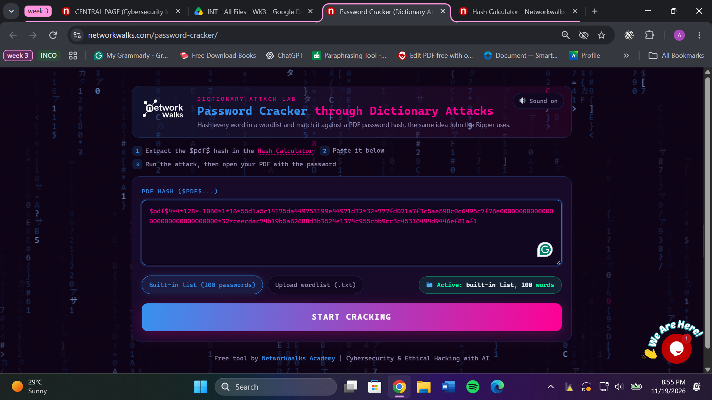
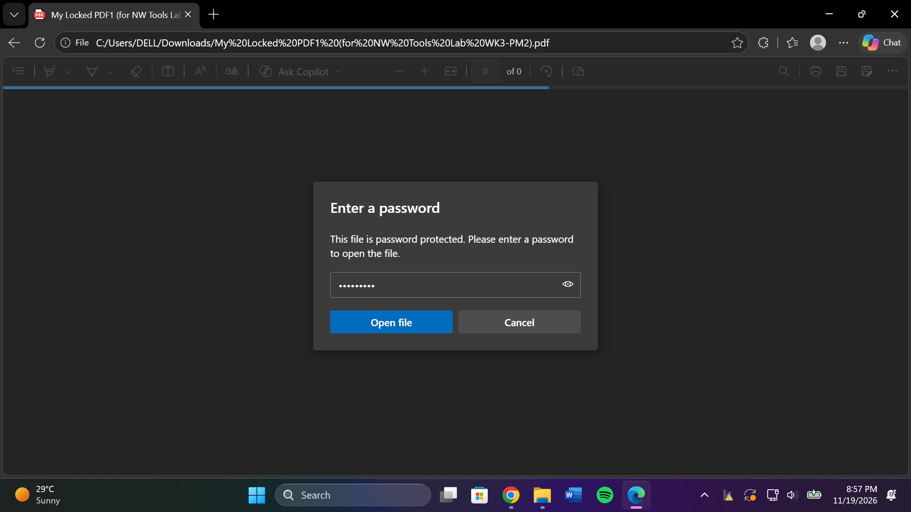

# Password Cracking Labs — Week 3 (Networkwalks)

This repository documents two hands-on cybersecurity lab modules focused on extracting password-derived authentication data from encrypted PDF files and recovering their passwords using local CLI/GUI tools in Kali Linux and browser-based utilities.

---

## 🛠️ Tools & Environment Used

- **Operating System:** Kali Linux
- **Module 1 Tools:** `pdf2john` (hash extraction), **John the Ripper** (`/usr/sbin/john`), **Johnny GUI**
- **Module 2 Tools:** Networkwalks Hash Calculator, Networkwalks Password Cracker (Dictionary Attack)

---

## 📁 Project Module 1: Password Cracking with John the Ripper & Johnny (Kali Linux)

### Objective

Extract the password-derived authentication data from a locked PDF document (`My Locked PDF1.pdf`) and recover the password using John the Ripper via the Johnny graphical interface on Kali Linux.

### Step-by-Step Workflow

1. **Install & Launch Johnny:** Updated the Kali package repository, installed Johnny, and launched the application from the terminal:

   ```bash
   sudo apt update && sudo apt install johnny -y
   johnny
   ```

   Johnny was then configured to use the John the Ripper executable at `/usr/sbin/john`.

2. **Extract the PDF Hash:** Converted the encrypted PDF into a crackable hash file using `pdf2john`:

   ```bash
   pdf2john "My Locked PDF1.pdf" > hash1.txt
   ```

3. **Crack the Password:** Loaded `hash1.txt` into Johnny and executed a password-cracking attack, recovering the password **`good-luck`**.

4. **Unlock & Capture Flag:** Opened the locked PDF using the recovered password and accessed the flag displayed inside the document.

### Key Results & Screenshots

- **Recovered Password:** `good-luck`
- **Captured Flag:** `nw{cybersecurity_flag_captured_2608}`

| Extracting Hash (`pdf2john`) | Cracking Password in Johnny | Unlocked PDF & Flag |
| :---: | :---: | :---: |
|  |  |  |

---

## 🌐 Project Module 2: Password Cracking with Networkwalks Web Tools

### Objective

Extract the `$pdf$` hash and perform a browser-based dictionary attack against an encrypted PDF (`My Locked PDF1 (for NW Tools Lab WK3-PM2).pdf`) using Networkwalks' password-cracking utilities.

### Step-by-Step Workflow

1. **Hash Extraction:** Uploaded the locked PDF to the **Networkwalks Hash Calculator** to extract the PDF's `$pdf$` hash.

2. **Dictionary Attack:** Pasted the extracted hash into the **Networkwalks Password Cracker** and ran a dictionary attack against the available wordlist, recovering the password **`password1`**.

3. **Unlock & Capture Flag:** Entered the recovered password into the PDF viewer to access the document and retrieve the displayed flag.

### Key Results & Screenshots

- **Recovered Password:** `password1`
- **Captured Flag:** `nw{networkwalks_flag1_jtr_270521_1}`

| Hash Calculator Extraction | Dictionary Attack Cracked | Unlocked PDF & Flag |
| :---: | :---: | :---: |
|  |  |  |

---

## 📸 Complete Screenshot Index

### Module 1 — John the Ripper & Johnny

**1. Johnny Installation & Launch**



**2. John the Ripper Path Configuration**



**3. PDF Hash Extraction**


**4. Password Recovery in Johnny**


**5. Unlocked PDF & Captured Flag**


---

### Module 2 — Networkwalks Web Tools

**6. Hash Extraction Using Networkwalks**


**7. Loading Hash into Password Cracker**



**8. Dictionary Attack & Password Recovery**


**9. Entering the Recovered Password**



**10. Unlocked PDF & Captured Flag**


---

## 💡 Key Takeaways

- **Hash Extraction & Password Recovery:** Encrypted PDF files contain password-derived authentication data that can be extracted into a format suitable for password-cracking tools such as John the Ripper.
- **Password Strength Matters:** Weak or commonly used passwords such as `password1` and `good-luck` can be recovered quickly when they are present in an effective wordlist, highlighting the importance of using strong, unique passwords.
